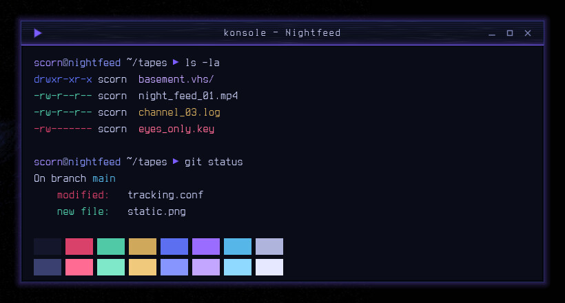

# Nightfeed — Konsole & kitty Colours

Cobalt-black terminal colours for Konsole and kitty, with a violet cursor and a cool 16-colour palette.



Nightfeed is a night-vision VHS look for KDE Plasma 6, built around a cobalt-lit face on near-black: cobalt-black surfaces, faint scanlines and tape grain, and a slight violet glow on whatever has focus.

## Features

- A blue-black background with pale periwinkle text and a violet block cursor.
- 16 colours tuned for the cobalt background: REC magenta, teal, amber, cobalt, violet and sky blue, plus bright variants.
- A Konsole profile with Terminess, a slight translucency and blur, and roomy margins.
- A kitty theme with matching tab and border colours.


## Requirements

Konsole and/or kitty. The profile uses Terminess Nerd Font if it is installed.

## Install

```bash
git clone https://github.com/numbpill3d/nightfeed-konsole
cd nightfeed-konsole && ./install.sh
```

Or from the KDE Store: Copy `Nightfeed.colorscheme` and `Nightfeed.profile` to `~/.local/share/konsole/`, then pick the profile in Konsole. For kitty, add `include nightfeed-kitty.conf` to kitty.conf.

## The rest of the suite

| piece | repo |
|---|---|
| SDDM login | [nightfeed-sddm](https://github.com/numbpill3d/nightfeed-sddm) |
| Plymouth boot splash | [nightfeed-plymouth](https://github.com/numbpill3d/nightfeed-plymouth) |
| Global theme + splash screen | [nightfeed-global](https://github.com/numbpill3d/nightfeed-global) |
| Plasma style (panel, popups) | [nightfeed-plasma](https://github.com/numbpill3d/nightfeed-plasma) |
| Aurorae window decoration | [nightfeed-aurorae](https://github.com/numbpill3d/nightfeed-aurorae) |
| Colour scheme | [nightfeed-colors](https://github.com/numbpill3d/nightfeed-colors) |
| Kvantum widget style | [nightfeed-kvantum](https://github.com/numbpill3d/nightfeed-kvantum) |
| Icon theme | [nightfeed-icons](https://github.com/numbpill3d/nightfeed-icons) |

Everything at once, with the generators: [nightfeed](https://github.com/numbpill3d/nightfeed).

## Tags

`nightfeed` `kde` `plasma6` `dark` `vhs` `scanlines` `cobalt` `violet` `purple` `retro` `analog-horror` `glow` `konsole` `kitty` `terminal` `colorscheme` `terminal-theme`

## Credits and licence

By splicer scorn (voidrane). GPL-3.0-or-later.
